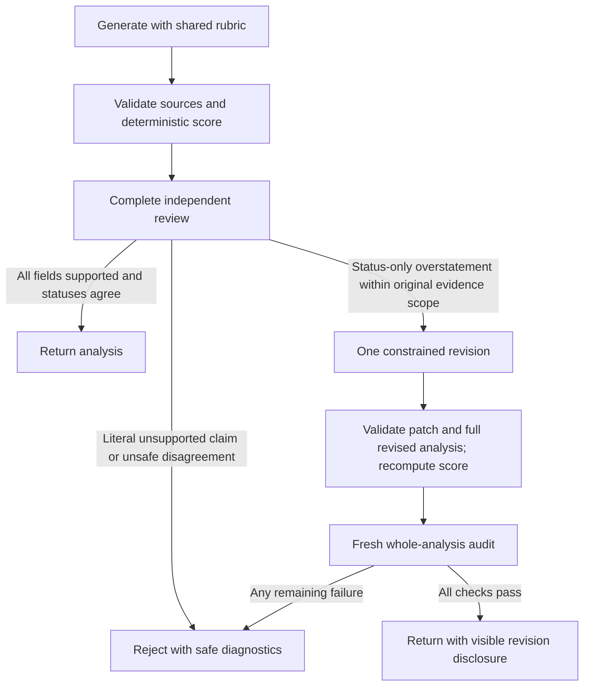

# Job analysis: shared assessment policy and independent review

## Confirmed production facts versus hypotheses

Worker version `f11e40ee-baa2-4c01-8501-c6661b342799`, request `f9e7103b-4fa4-4d84-bf56-a35a85d0af97`, returned HTTP 422 / `UNSUPPORTED_CLAIM`. The independent model audit reported four `unsupported_candidate_fact` violations at `requirements.0.status`, `.3.status`, `.6.status`, and `.7.status`.

This confirms a **semantic audit rejection of four statuses after application validation**, not an extraction URL, unknown-reference, JSON/schema, authentication or provider HTTP failure. It does not identify the original statuses or evidence, prove a false positive, or prove that the primary analysis invented a qualification. The private generation/audit transcripts were not supplied. No production data or paid model calls were used in this investigation.

Code inspection confirms an architectural contract gap: generation and review receive the same verified profile and fact inventory, but their different system instructions do not share a precise operational definition of direct coverage, partial coverage, transferable alignment or ambiguous requirements. Generation is asked to support matches, while the audit separately demands entailment and a supported subset. The generic `unsupported_candidate_fact` code can conflate a literal invented qualification with disagreement about an alignment judgment. An audit verdict with sparse violations provides no complete independent assessment or evidence basis for diagnosing the difference.

Both roles use the same configured `OPENAI_MODEL` in separate stateless calls; they are not two differently configured model engines. The distinction is task/prompt/context, not a separate evidence database. No ID-map or source omission between the two calls was found. Independent invocations of the same model may still have correlated errors and stochastic semantic disagreements.

Remaining hypotheses for the actual four rows are genuine primary-model overstatement, an over-strict audit, ambiguous job scope/compound requirements, differences about transferable experience, or a combination. Current metadata cannot choose among them. The synthetic four-row fixture is not a reconstruction of private production text; it tests the architectural response to a representative disagreement.

## Shared, versioned assessment contract

`worker/assessment-policy.ts` defines `evidence-alignment-v1`. The exact same object is included in generation, revision and audit data, and the same serialized rubric is embedded in all three system instructions. A single source envelope supplies the verified profile, candidate fact map, job description and optional job metadata throughout the request. Source text cannot override this application-owned policy.

| Assessment | Required meaning |
| --- | --- |
| `met` / direct | Cited candidate facts support every material aspect, including named credentials, domain and quantified thresholds. Unambiguous semantic equivalents count; keyword identity alone is not the rule. |
| `partial` / subset | Verified facts support a material component of a compound requirement; identify the uncovered component explicitly. |
| `partial` / transferable | A specific, defensible transferable competency is evidenced. State both the transfer and the exact qualification not evidenced; do not claim the named skill/credential is held. Generic employability/unrelated experience is insufficient. |
| `missing` / none | No supporting match evidence. This means not evidenced, not never experienced. Atomic named credentials or duration thresholds need direct evidence; unrelated/adjacent work cannot satisfy them. |
| Ambiguous scope | Never `met` without resolving material scope. Relevant verified evidence can justify caveated `partial`; otherwise `missing`. Do not invent a stricter job requirement to resolve ambiguity. |

The basis-to-status and basis-to-reason tables are shared with runtime checks and model instructions. Examples: verified TypeScript with no Python can partly cover a TypeScript-and-Python requirement; React can be specifically described as transferable component-framework work without claiming Vue proficiency; general developer dates do not establish five years of distributed systems work; React plus no AWS certification partly covers a compound React-and-certification requirement, while the atomic certification remains missing.

Fact accuracy and fit interpretation are distinct questions. Evidence text must remain supported by candidate facts. A reasonable rubric-consistent partial judgment is not automatically a literal claim that an absent qualification is held. Conversely, an invented employer, skill, achievement, certification, degree or duration remains an unsupported fact even if accompanied by valid IDs or a cautious status.

## Complete independent evidence review

The audit must now return exactly one `statusReviews` row for every returned requirement: index, assessed status, evidence basis, reason code and supporting candidate fact IDs. It still returns a whole-analysis verdict and field-level violations for all fields, including narratives and recommendations. The provider schema constrains row count/index bounds and uses the same approved-ID inventory where provider enum limits permit. Local validation enforces:

- Complete, unique in-range indexes; no missing/unreviewed row.
- Coherent basis/status/reason combinations and nonempty supporting references for met/partial; missing requires [].
- Actual membership in the approved fact map, plus evidence scope checks for an approved result.
- Explicit status-path violations for every disagreement; no unreported mismatch or contradictory supported verdict.
- Existing strict schema, job quotation membership, unique requirement IDs, source-reference/status invariants and shared scoring rules.

The audit uses `status_disagreement` for a status-only rubric disagreement, and `evidence_deficiency` for unsupported/irrelevant evidence. Literal invented candidate assertions retain `unsupported_candidate_fact` or the existing more specific rules. Known IDs never substitute for entailment. The application does not reinterpret an old `unsupported_candidate_fact` label as harmless disagreement based on its path.

A correct direct/partial/missing/transferable/ambiguous matrix passes with two calls. Genuine missing qualifications are successful analysis results with [] and a reduced deterministic score; gaps are not themselves request failures.

## Bounded revision and mandatory fresh re-audit

Only an audit containing **exclusively** `status_disagreement` violations at requirement status paths can initiate revision. Every changed assessment must be a downgrade (`met` to partial/missing, or partial to missing) and stay within that row's originally cited evidence. Missing qualifications cannot be upgraded automatically. A factual assertion/evidence failure anywhere makes the whole response fatal without repair.

The reviser returns a strict patch, not a replacement profile or analysis. It may change only flagged rows' status, nonempty evidence explanation and a subset of originally cited fact IDs. It cannot add/drop rows; change requirement IDs, text, mandatory/preferred weights, categories or job quotations; cite new evidence; change other rows; or rewrite strengths/gaps/recommendations/alignment narrative. All original professional/job facts remain untouched. Application checks reject duplicate, missing, extra, upgraded or out-of-scope patches before another model audit.

The entire revised draft then runs the same source/reference validation and deterministic score calculation. A processing disclosure is appended to the existing visible/saved `experienceAlignment` field, naming each changed one-based requirement number and old/new status. This preserves the public API and IndexedDB/backup schemas. Existing text is not truncated; if a disclosure cannot fit the strict field bound, validation fails closed rather than discarding professional text. The approved profile is never modified.

The final audit receives the entire revised analysis, unchanged source envelope and same rubric, with process metadata explaining the application-owned disclosure. It does not receive the first auditor's verdict, violations or requested patches as instructions to agree. It must independently validate every status, reference and narrative claim again. Any invented fact introduced by the reviser, contradiction with unchanged narratives, malformed review or further disagreement is fatal. No third generation/retry is permitted.

Normal requests use two OpenAI calls; eligible revision requests use at most four. All calls share the existing 55-second request abort signal and existing rate limiting; there is no extended timeout, quota bypass or hidden retry loop. A timeout/provider failure returns the existing safe error and no partial result. Eligible revisions add latency and potential usage cost; existing OpenAI project budget/usage controls remain relevant and are not changed here. No deployment/Cloudflare settings were modified.

## Privacy-safe diagnostics

`assessment_review` / `ANALYSIS_REVIEW_REJECTED` reports the policy version, attempt (0 or 1), revision eligibility, disagreement/evidence-deficiency counts, and at most twelve assessment metadata rows. Disagreements are prioritized before contextual missing/ambiguous rows. Each entry contains only index, proposed/reviewed status, basis, enum reason and reference count.

Reason codes distinguish direct evidence, incomplete coverage, transferable alignment, no supporting evidence, ambiguous job scope, non-entailing citations, unevidenced credentials and unevidenced duration. These are assessment context; an agreed missing row is not itself a violation. Existing `factuality` events retain the actual fatal violation rules/paths. Original source-reference diagnostics remain intact.

No requirement text, candidate/job content, model explanation, source quote, fact ID, identity or credential is logged. All strings in new metadata are enum/application constants; indexes/counts are bounded and validated. Unsupported/private reason values, out-of-range indexes and forged evidence fail validation. Logging failures cannot change acceptance behavior.

## Verification and limits

A realistic eight-requirement Worker fixture exercises direct accessibility/degree matches, compound TypeScript/Python coverage, a compound React/credential requirement, a genuine AWS credential gap, transferable React/Vue alignment, a missing duration/domain threshold and ambiguous architecture scope. A representative four-row overstatement at positions 0/3/6/7 is revised once, revalidated, rescored and fully re-audited, with visible disclosure. The test proves source/rubric identity across all calls, immutability, score integrity and no reviewer-verdict leakage into the fresh audit.

Other regressions reject literal fabricated claims, evidence deficiencies, legacy candidate-fact violations at status paths, a second rejection, incomplete/duplicate/out-of-range/incoherent reviews, unknown evidence, private diagnostic payloads, unsafe patches, missing-to-partial upgrades, newly introduced references, changed job criteria, erased evidence and aborts. Failed revised results leave profile/history/analysis/resume stores unchanged. Existing public API, approval, Access, rate-limit, source-reference, extraction, resume and Windows subprocess regressions are retained. Legacy mock audit helpers now explicitly supply complete synthetic status reviews; those helpers are not a live-model oracle.

These mocked transcripts validate the architecture and hard invariants, not semantic accuracy on unseen production evidence. The shared rubric removes a confirmed contract inconsistency; it does not prove the original four assessments were legitimate, or guarantee that the configured model never errs. Independent factuality review remains mandatory, and genuine unsupported qualifications remain blocked. No paid OpenAI requests, merge or deployment were performed.

Local validation passed: 527 Vitest tests (including 27 new assessment-review regressions), 7 legacy tests, 3 PDF integration tests and all 7 browser workflows (the existing six-workflow run plus a targeted visible-disclosure/saved-score workflow). The browser disclosure case confirms the revision notice is displayed and stored with the recomputed score while approved profile/history remain unchanged. Strict TypeScript/Vite same-origin production build and same-origin Wrangler dry-run passed. Local workerd routing passed: HTML 200/two root assets, unauthenticated API 401, unknown API 404 and wrong origin 403. Existing source-reference, canonical compatibility, privacy, Access and Windows subprocess regressions remain passing. `git diff --check` passed.
